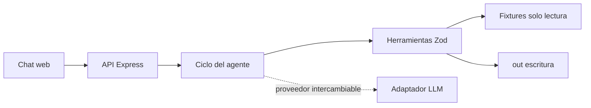

# Solución — Agente de registro como proveedor

## 1. Problema

La analista administrativa pierde tiempo y precisión transcribiendo datos repetidos de Periferia a formatos de clientes; el agente prepara formularios y soportes trazables sin inventar datos.

## 2. Arquitectura

El comportamiento está en `agent/prompt.md`, el conocimiento de proceso en `src/knowledge/registro-proveedor.md` y la ejecución determinista en `src/tools/proveedor.ts`. El front consume la API y muestra cada llamada, argumento y resultado.

## 3. Ciclo del agente

El backend conserva sesiones en memoria y aplica un máximo configurable de iteraciones (`MAX_AGENT_ITERATIONS`, por defecto 12) y tokens acumulados (`MAX_SESSION_TOKENS`, por defecto 40000). Con `GEMINI_API_KEY`, el ciclo carga `agent/prompt.md` y `src/knowledge/registro-proveedor.md`, envía historial y definiciones de herramientas al adaptador Gemini, valida cada argumento con Zod, ejecuta el resultado y lo devuelve como `functionResponse` hasta obtener respuesta final o alcanzar un tope. Cada herramienta devuelve JSON serializado y no lanza excepciones. Sin clave, el modo determinista existe únicamente para permitir `demo.ts` y una demostración local repetible con los fixtures.

El envío simulado solo puede solicitarse para un paquete procesado y `listo_para_firma`; el servidor solicita confirmación y la acepta exclusivamente en el siguiente turno. La simulación solo escribe `ENVIO-SIMULADO.md` y activa una notificación visual; no integra correo real.

## 4. Elección del modelo

El adaptador de Gemini (`src/llm/gemini.ts`) usa `gemini-3.8-flash` por defecto y el SDK oficial `@google/genai`, con llamadas a funciones nativas. La clave vive solo en `GEMINI_API_KEY` del backend. El ciclo conserva la respuesta nativa del modelo y responde las herramientas con bloques `functionResponse`. `MAX_AGENT_ITERATIONS` y `MAX_SESSION_TOKENS` limitan llamadas y consumo acumulado por sesión; el costo final depende del precio vigente del modelo y del volumen de tokens.

## 5. Diseño del portal web

En producción usaría navegador controlado por el agente, con selectores versionados y comprobaciones antes de cada paso. CAPTCHA, MFA y cambios de layout suspenden la automatización y se elevan al humano. Las credenciales se almacenarían en un gestor de secretos corporativo, nunca en el repositorio, prompt ni logs; el representante legal las ingresaría en una sesión visible. El agente prepara valores y adjuntos; el humano ingresa las credenciales y hace clic en **Enviar**.

## 6. Decisiones y trade-offs

1. **JSON de plantillas → XLSX/PDF generado**: los fixtures no traen archivos binarios originales, por lo que se reconstruye el formato con sus posiciones/orden. Se descartó simular archivos originales inexistentes.
2. **Herramientas deterministas antes que extracción LLM**: evita alucinaciones en NIT y datos bancarios. Se descartó dejar el mapeo al modelo.
3. **Sistema de archivos para salida**: satisface el alcance sin base de datos. Se descartó persistencia externa por no aportar al reto.
4. **Envío simulado**: conserva el control humano. Se descartó cualquier integración real de correo por ser no objetivo.

## 7. Supuestos

- Los fixtures son fuente de verdad del reto.
- La fecha de ejecución determina la vigencia de soportes.
- Si una etiqueta no existe en el glosario, queda faltante.
- Los campos de una plantilla portal se representan mediante `plantilla-campos.json`.

## 8. Cobertura

| Historia | Estado | Alcance |
|---|---|---|
| HU-1 | Hecho | Lee solicitud, campos, país, formato y soportes. |
| HU-2 | Hecho | Mapea con glosario y evidencia de ruta; faltantes y confirmación para reglas de país o confianza menor a 0.8. |
| HU-3 | Hecho | Genera XLSX, PDF y valores de portal. |
| HU-4 | Hecho | Copia soportes exigidos existentes, marca vencidos/ausentes, redacta correo y simula envío bajo confirmación. |
| HU-5 | Hecho | Errores tipados y mensajes no crudos. |

La aplicación local cumple las HUs con los fixtures. La publicación temporal gratuita en Cloudflare Workers ofrece una URL pública demostrable sin secretos y sin acciones externas; para producción faltarían autenticación, almacenamiento seguro de secretos, repositorio documental real, observabilidad y un despliegue persistente con las variables de entorno configuradas.

## 9. Uso de IA

Se usó PERXIA como asistente de desarrollo para revisar el PRD y fixtures, estructurar la solución e implementar código. Se descartó cualquier propuesta que inventara valores de proveedor, alterara fixtures o expusiera claves. La persona responsable revisa y puede explicar el código entregado.

## 10. Publicación y operación

La publicación gratuita se implementa como Cloudflare Worker con los activos estáticos de `web/`. La URL temporal de la entrega se registra en `README.md`. Su Worker usa modo demostración para no almacenar secretos ni ejecutar correo real. La aplicación completa se ejecuta localmente con `npm run dev`; `npm run deploy:cloudflare` publica una versión persistente al autenticar Wrangler. La verificación obligatoria es `npm run typecheck`, `npm run lint` y `npm run demo`.

## 11. Riesgos y mitigación

- **Maestro desactualizado:** asignar propietario, control de vigencia y auditoría de cambios.
- **Plantillas reales variables/corruptas:** validación previa, reporte accionable y pruebas por cliente.
- **Datos sensibles:** mínimos privilegios, secretos en vault, cifrado y redacción de logs.
- **Alucinación de modelos:** herramientas como fuente exclusiva, mapeos trazables y confirmación humana.
